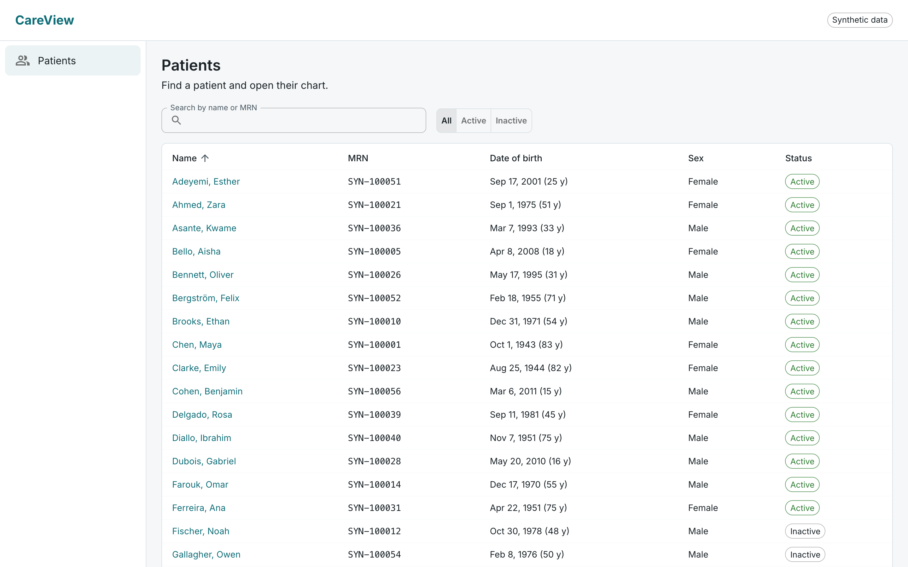
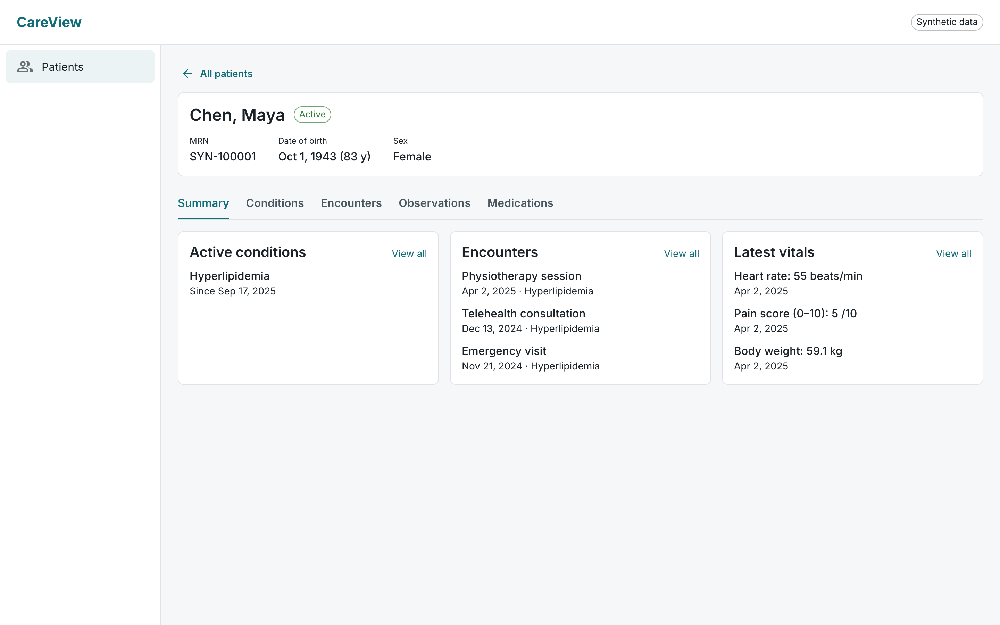
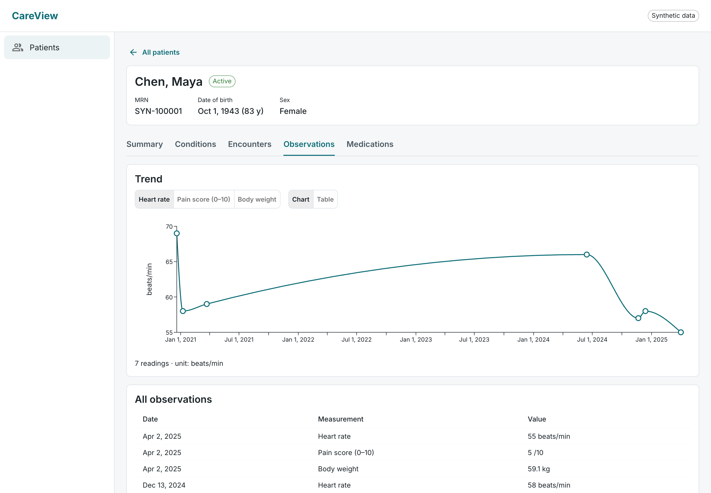
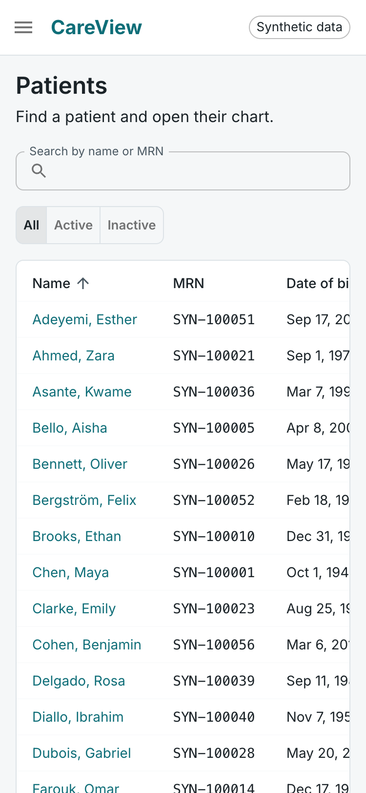
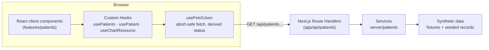

# CareView

A clinical patient-overview app built with **Next.js, React and TypeScript**. Search a patient directory, open a
patient chart, and review conditions, encounters, observations and medications, with trends you can read as a chart
or a table.



> **Synthetic data only.** Every patient is fictional (MRNs start with `SYN-`). Not for clinical use; no PHIPA/HIPAA
> compliance is claimed. There is no login in this release.

## What you can do

| Patient chart: summary | Observation trend |
|---|---|
|  |  |

- **Find a patient:** search by name (either order) or MRN as you type, filter by active/inactive, sort by name or
  date of birth, and page through results. Page, sort and filter live in the URL, so a refresh or a shared link keeps
  the view. The search text deliberately does not (see [Privacy](#privacy-by-design)).
- **Open a chart:** a banner (name, MRN, date of birth with age, sex, status) stays on every section: Summary,
  Conditions, Encounters, Observations, Medications.
- **Read a trend:** pick heart rate, pain score or body weight and switch between a chart and a table. The chart is
  never the only way to read the data.
- **On a phone:** the layout adapts. Navigation moves into a menu, and wide tables scroll inside their card.



## Demo script (about 3 minutes)

1. **Directory.** Open `/patients`. Type `chen`: one request goes out when you pause (debounced), and only Maya Chen
   matches. Clear it, sort by **Date of birth** and go to page 2: the URL shows `?page=2&sort=birthDate`. Choose
   **Inactive** and the list returns to page 1 (`?status=inactive&sort=birthDate`). The search text never appears in
   the URL.
2. **Chart.** Click a patient. The banner stays put as you move between sections, and each section loads on its own.
3. **Summary.** Active conditions, an upcoming visit if there is one, and the latest vital of each type.
4. **Trend.** On **Observations**, switch from heart rate to pain score, then to **Table**.
5. **Edge cases.** Visit `/patients/pt-999` ("Patient not found"), `/no-such-page` (404), or search for `zzzz`
   ("No patients match", with a one-click reset).
6. **Keyboard.** Reload and press Tab: "Skip to main content" appears first. The status filter is a single Tab stop
   with arrow keys.

## Architecture



- **The browser only talks to the app's own REST API.** Route handlers validate input and return one consistent
  error shape (`{ error: { code, message } }`), and send `Cache-Control: no-store` on every response.
- **Server-only code** (`src/server/**`) starts with `import "server-only"`, so the build fails if a client component
  imports it.
- **Data:** 60 fictional patients are committed one per line. Their clinical records are generated from a fixed seed
  per patient, so tests and screenshots are repeatable. There's no database; persistence isn't a requirement.

```
src/
  app/                    routes: /patients, /patients/[patientId]/{conditions,encounters,observations,medications}, api/
  components/             shared UI: layout/ (AppShell, PageHeader), feedback/ (Loading/Empty/Error), data-display/
  features/patients/      components/, hooks/, utils/, types.ts (shared with the API)
  server/                 http.ts (responses), patients/ (fixtures, services)
  theme.ts                MUI theme (WCAG AA palette)
```

Full details: [`docs/ARCHITECTURE.md`](docs/ARCHITECTURE.md). Scope and priorities: [`PROJECT_PLAN.md`](PROJECT_PLAN.md),
[`docs/PRIORITIES.md`](docs/PRIORITIES.md).

## Decisions worth explaining

| Decision | Why |
|---|---|
| **Custom `useFetchJson` instead of TanStack Query** | Two data shapes, no need for caching. The Hook aborts superseded requests, ignores responses that arrive after an abort (a race the tests caught), and works out "loading" from its stored result rather than setting state in an effect. TanStack Query would be the next step if cross-tab caching became a need. |
| **`keepPreviousData` off by default** | The directory keeps the previous page visible while the next loads (no flashing). A chart must **never** show the previous patient while another loads, which would be a wrong-patient display. |
| **Hand-built table instead of a data grid** | Server-driven paging, sorting and filtering wired by hand show the React work a grid would hide. |
| **Page, sort and filter in the URL; search text in state** | The list view is shareable and survives refresh, while names and MRNs never reach the address bar, history or logs. |
| **Section navigation as links, not ARIA tabs** | Each section is a route, so they're links with `aria-current="page"`, the correct semantics for navigation. |
| **Context not used** | No state is shared between distant components. Adding Context only to demonstrate it would add coupling for nothing. |
| **Next.js `cacheComponents` kept on** | Next's docs make it the default in the next major. It shaped two rules: anything reading the URL renders inside `<Suspense>`, and API routes must read the request, or Next prerenders them as a frozen response (verified both ways). |
| **`@mui/x-charts` pinned to 9.17.0** | 9.18.0 depends on a vendor package published without its CommonJS files (80 of 354), which breaks Jest. |

## Testing

**158 tests in 27 files** (Jest + React Testing Library + user-event), all run in CI on every pull request.

- **Behaviour, not implementation:** queries by role and label; user-event for typing, clicking and keyboard use.
- **Every request state:** loading, empty, error with retry, success, "page past the end", not found.
- **Accessibility:** jest-axe on every component, a palette contrast test (axe can't measure contrast in jsdom), and
  keyboard-path tests.
- **API:** routes, query validation (errors never echo the search), and services.
- **Data:** invariants, plus a determinism test for the generated records.
- **Negative checks:** for important guards, the check was shown failing once (for example, removing the debounce
  sends 4 requests and fails its test) before being trusted.
- **Real browser:** headless Chrome over the DevTools protocol against a production build. It measured layout at
  375 px (found and fixed a page overflow) and inspected the chart SVG.

## Setup

Requires Node 24 (see `.nvmrc`).

```bash
npm install
npm run dev        # http://localhost:3000
```

| Command | What it does |
|---|---|
| `npm run lint` | ESLint (Next.js rules) |
| `npm run typecheck` | TypeScript, strict |
| `npm run format` / `format:check` | Prettier |
| `npm test` | Jest + React Testing Library |
| `npm run build` | Production build |

## Privacy by design

- Synthetic, fictional data only.
- Names, MRNs and birth dates are kept out of URLs, page titles (tab titles end up in browser history), logs and
  error messages.
- The app-wide error boundary never displays or logs an error's message.
- API responses are `no-store`.

## Known limitations and roadmap

- **No login or authorization.** Role-aware views would come with real authentication, enforced on the server.
- **Unknown patient IDs** show "Patient not found" in the browser, but the page responds with HTTP 200, because the
  chart loads data on the client.
- **Data is static and synthetic**, with no persistence or editing.
- **Not deployed.** Vercel is the natural target: no configuration needed beyond linking the repository.
- **Possible extensions** (deliberately deferred; see [`docs/PRIORITIES.md`](docs/PRIORITIES.md)): a FHIR-shaped
  adapter behind the existing API contract, one HL7 v2 import slice, persisted preferences.

## How it was built

Each milestone was planned, implemented on a branch, verified (lint, typecheck, format, tests, build), and
squash-merged through a pull request with CI. That gives one commit per step on `main`, from
[#1 Foundation](https://github.com/johnBaloran/careview/pull/1) to
[#12 Mobile fixes](https://github.com/johnBaloran/careview/pull/12). Progress and evidence are in
[`PROGRESS.md`](PROGRESS.md).
